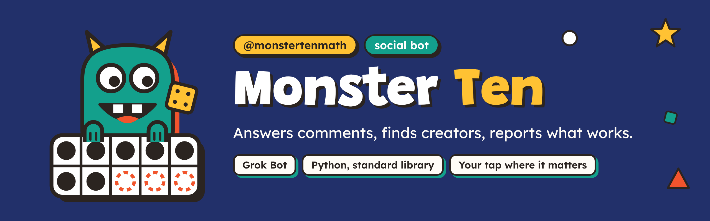
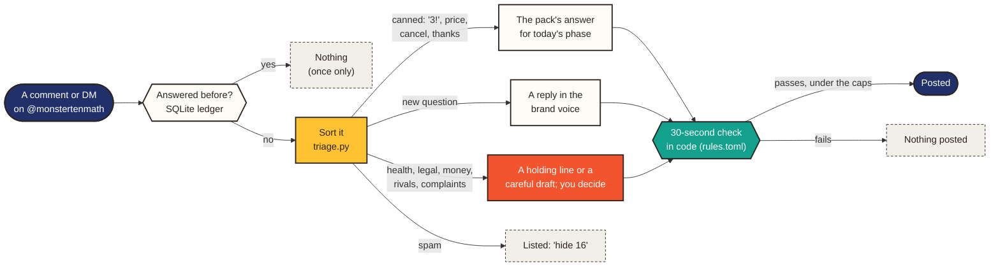
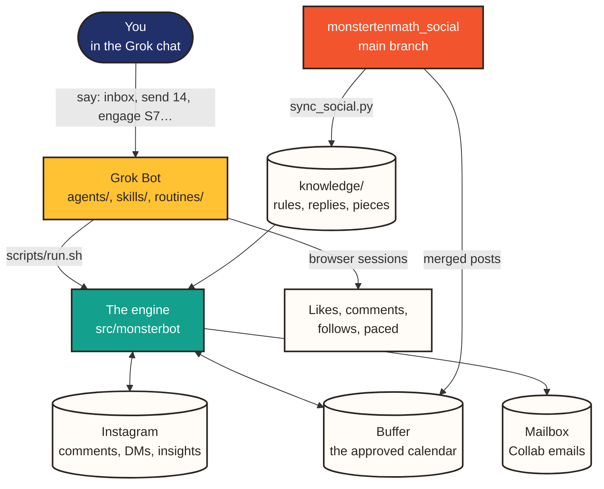

<p align="center">
  <a href="https://www.instagram.com/monstertenmath/"></a>
</p>

<p align="center">
  <a href="https://github.com/fairgradient-ai/monstertenmath-grokbot/actions/workflows/ci.yml"></a>
  
  
  
  
</p>

<p align="center">
  <a href="DESIGN.md">Design</a> ·
  <a href="SETUP.md">Setup</a> ·
  <a href="routines/autoreview.txt">What needs your tap</a> ·
  <a href="knowledge/rules.toml">The check in code</a> ·
  <a href="https://github.com/fairgradient-ai/monstertenmath_social">Social repo</a>
</p>

A Grok Bot that works as [@monstertenmath](https://www.instagram.com/monstertenmath/)'s social agency under the launch
pack's rules: it **answers every comment and DM**, **finds the right creators** and writes them Collab emails, likes,
comments and follows in the Grok browser with human pauses, **keeps Buffer in step** with the approved calendar, and
**reports what works**: insights, ads worth promoting, content pillars and posting times. It learns how you answer, and
asks you only about a child's health, legal, rivals, complaints and money.

Built from the launch pack in [fairgradient-ai/monstertenmath_social](https://github.com/fairgradient-ai/monstertenmath_social)
(`instagram/README.md` sections 6–7, `instagram/growth-plan.md` 6.2 and 6.5), in the shape of
[kapadias/pickletime-grokbot](https://github.com/kapadias/pickletime-grokbot). The design and the reasons are in
[`DESIGN.md`](DESIGN.md); setting it up is [`SETUP.md`](SETUP.md).

## Contents

- [How a comment is answered](#how-a-comment-is-answered)
- [What it does](#what-it-does)
- [Say these](#say-these)
- [What protects you](#what-protects-you)
- [How it fits together](#how-it-fits-together)
- [Layout](#layout)
- [Development](#development)

## How a comment is answered



In rehearsal (where it starts) the "Posted" step only shows what it would say.

## What it does

| On…                                       | The bot                                                                 |
| ----------------------------------------- | ----------------------------------------------------------------------- |
| "3!" on Reel #3                           | Replies "Yes! 7 and 3 make 10." by itself                               |
| "Is this AI?"                             | Replies with that Reel's own AI line, by itself                         |
| "How much?", "Where's the link?"          | The pack's answer for today's phase and price (founding or standard)    |
| "Can I cancel anytime?"                   | The pack's cancel answer, with the trial terms whole, by itself         |
| "Love this!"                              | A thank-you, by itself                                                  |
| "Does it work for a 3 year old?"          | Writes a reply in the brand voice and posts it once it passes the check |
| A DM: "How much is it?"                   | The same answers, in the DM thread (once Meta grants DM access)         |
| "I was charged twice", "teacher license?" | A holding line ("email us at info@…") at once, and tells you            |
| "My son has ADHD, would this help?"       | Drafts a careful reply and waits for your one-word OK                   |
| "Promote it on @…"                        | Lists it as spam; "hide 16" hides it                                    |

It also posts each new post's first comment for you to pin, compares followers with the pace line, finds and
scores creators by the growth plan's criteria, drafts Collab emails you send with one tap, and three times a
day sends a **brief**: fresh posts from those creators, each with a comment written for it, for you or a helper
to post.

Since v1.0 it also likes, comments and follows on other accounts in the Grok browser, but only in a session
you start ("engage S7"), one step at a time with random breaks, under caps that ramp over two weeks, and it
stops for 48 hours at any warning ([`DESIGN.md`](DESIGN.md), section 3: your decision, and the risk it carries).
Since v1.1 each session also has **feed steps**: Grok scrolls our home feed, picks a fitting post from a parent,
teacher or creator, writes a fresh comment for it, and the engine checks the post and the comment before anything
is clicked. Follows start on day 0 at a low cap (10 a day in week one) from parents who commented, fitting
creators and accounts we engaged with. "Auto engage on" (one tap) lets the brief routines run sessions themselves
under the same caps; any warning turns it off. It never unfollows or DMs other accounts. It keeps Buffer in step with `schedule.json` on the social repo's
`main` (merged posts only), and every Sunday scores the pillars and proposes new ones. Every reply, comment,
caption and email passes the pack's 30-second check in code first ([`knowledge/rules.toml`](knowledge/rules.toml)).

## Say these

| Say                        | It does                                                   | Your tap? |
| -------------------------- | --------------------------------------------------------- | --------- |
| "check the comments"       | A sweep, then writes and posts the replies that pass      | no        |
| "inbox"                    | Everything waiting for you                                | no        |
| "send 14" / "send all"     | Posts the drafts that wait for your OK                    | **yes**   |
| "edit 14: …"               | Your words instead of the bot's (and it learns from them) | send: yes |
| "skip 14"                  | No reply                                                  | no        |
| "hide 16"                  | Hides a comment                                           | **yes**   |
| "find creators"            | Scouts, scores, shortlists, drafts Collab emails          | no        |
| "send all outreach"        | Emails the drafted Collab offers                          | **yes**   |
| "brief"                    | Fresh creator posts, each with a comment ready to post    | no        |
| "done 12 13"               | Marks brief comments as posted                            | no        |
| "examples"                 | What the bot has learned from your replies                | no        |
| "stats"                    | Followers against the pace line, and the newest posts     | no        |
| "we're open"               | Switches the answers to the launch phase (after the gate) | **yes**   |
| "founding price on"        | Price answers give the founding price, its terms whole    | **yes**   |
| "founding price closed"    | Back to $59.99 / $7.99; founding questions come to you   | **yes**   |
| "go live" / "stop posting" | Replies post by themselves / nothing posts                | **yes**   |
| "engage S7"                | Runs browser session S7: likes, comments, follows, paced  | **yes**   |
| "engage now"               | Plans a session now and asks for "engage S<n>"            | no        |
| "auto engage on"           | Routines run up to 3 paced sessions a day, no tap each    | **yes**   |
| "auto engage off"          | Back to one tap per session                               | no        |
| "stop engaging"            | Stops browser sessions for 48 hours                       | no        |
| "sync Buffer"              | Merged posts from main into Buffer, then an audit         | no        |
| "delete #512 from Buffer"  | Deletes one scheduled post (also remind, restore, push)   | **yes**   |
| "insights" / "ads"         | How posts did / what's worth promoting (never spends)     | no        |
| "pillars" / "pillar yes 2" | Pillar scores and proposals / adopts one                  | no        |

## What protects you

- **Rehearsal first.** It starts by posting nothing and showing what it would say.
- **The check in code.** Outcome promises, "test" or "screening", countdowns, hashtags, rivals, links before
  launch, half the trial terms, a store the app isn't in: any of these and nothing is posted.
- **The founding price only while it's on.** It stays off until you've seen it on the site's ticket and said
  "founding price on". Then every mention carries its terms (the first 500 families), and no
  reply ever says how many places are left. Once you say it's closed, the bot never names it again.
- **Your tap where it matters.** Sensitive replies, Collab emails (they offer money), hiding, the phase and the
  mode go through Grok's Ask-first cards ([`routines/autoreview.txt`](routines/autoreview.txt)), and the
  engine refuses them without it.
- **Once only.** A SQLite ledger means a comment or DM is answered at most once, even when a sweep and a send
  overlap or Instagram times out.
- **Caps.** One canned reply per person per post a day, 20 a sweep, 60 posts a day without your tap, 10
  outreach emails a day. A creator who says no is never written to again.
- **Secrets** stay on the secret card and are never printed.

## How it fits together



## Layout

| Path                          | What                                                                      |
| ----------------------------- | ------------------------------------------------------------------------- |
| `agents/`                     | The Grok Bot's profile and system prompt                                  |
| `skills/`                     | Setup, day-to-day operations, and the brand voice                         |
| `routines/`                   | When it runs (`manifest.toml`) and what needs your tap (`autoreview.txt`) |
| `knowledge/`                  | The pack as data: the rules, the replies, the 15 pieces, the Collab email |
| `src/monsterbot/`             | The engine: Python 3.11+, standard library only                           |
| `scripts/`                    | `run.sh` (the only entry point), `install.sh`, `env.sh`, `sync_social.py` |
| `config/config.template.toml` | The desk's config: account, caps, DMs, scout, outreach, pace line         |
| `tests/`                      | 407 offline tests against a fake Instagram, Graph and mailbox             |

## Development

> [!NOTE]
> The QA team (in the monstertenmath repo, `qa/`) runs this repo's `pytest` every night and, weekly, the bot in
> rehearsal only.

```bash
# Tools (the engine itself needs nothing beyond Python 3.11+)
pip install pytest ruff

# Tests and lint
pytest -q && ruff check src tests scripts

# A local desk against the fake Instagram
MT_DESK=/tmp/desk MT_CHANNEL=fake:src/monsterbot/fixtures/fake_instagram.json bash scripts/install.sh

# One sweep at a fixed time, in rehearsal
MT_DESK=/tmp/desk MT_CHANNEL=fake:src/monsterbot/fixtures/fake_instagram.json MT_NOW=2026-11-20T02:00:00+00:00 bash scripts/run.sh sweep
```

Changes arrive by pull request into `main` (a merged PR means **Done** in Linear, Area label: bot). Every branch but
`main` is deleted once merged. A change to replies or rules is a change to what the account says: keep it in step with
the launch pack.

<p align="center"><sub>© 2026 fairgradient.ai LLC · <a href="https://monstertenmath.com">monstertenmath.com</a> · <a href="https://www.instagram.com/monstertenmath/">@monstertenmath</a></sub></p>
